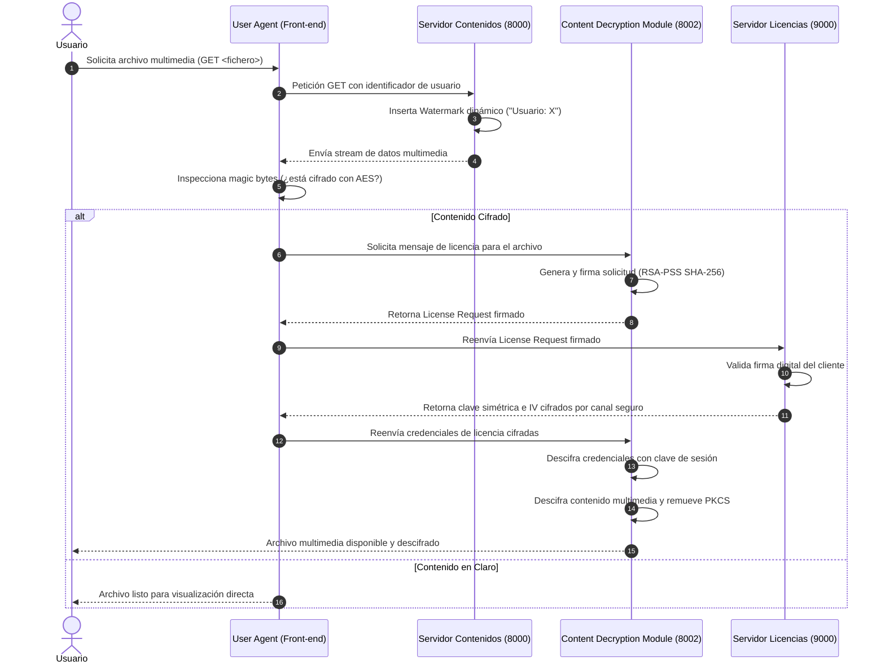

# Sistema de Gestión de Derechos Digitales (DRM) con Criptografía Híbrida


Prototipo funcional de un sistema de protección y distribución segura de contenidos multimedia (**Digital Rights Management - DRM**), implementado en Python. El proyecto reproduce los fundamentos arquitectónicos y criptográficos empleados en estándares de la industria como **W3C Encrypted Media Extensions (EME)** y sistemas comerciales tipo Widevine y FairPlay.

---

## 📌 Aspectos Destacados del Proyecto

- **Criptografía Híbrida**: Negociación de sesión mediante cifrado asimétrico **RSA-2048** con esquema de relleno **OAEP (SHA-256)**, garantizando canales confidenciales sobre los cuales se transportan claves simétricas **AES-128-CBC** con padding **PKCS#7**.
- **Autenticación y No Repudio mediante Firmas Digitales**: Emisión y validación de firmas digitales probabilísticas **RSA-PSS** con **SHA-256** para autorizar peticiones de licencias antes de liberar material criptográfico.
- **Marca de Agua Forense Dinámica (Watermarking)**: Inyección en tiempo real del identificador del usuario sobre contenidos visuales (imágenes JPEG, PNG, JFIF), procesando tanto medios en claro como flujos previamente cifrados para trazabilidad contra redistribución no autorizada.
- **Detección Heurística de Cifrado**: Análisis en tiempo de recepción mediante verificación de firmas binarias (*Magic Bytes*) y comprobación de límites de alineación de bloque (múltiplos de 16 bytes).
- **Arquitectura Desacoplada (Modelo W3C EME)**:
  - **User Agent (UA)**: Frontal de usuario encargado del transporte de red y la orquestación.
  - **Content Decryption Module (CDM)**: Módulo criptográfico aislado (*sandbox*) que custodia las claves privadas, firma las solicitudes de licencia y descifra el contenido protegido sin exponer las claves maestras.
  - **Servidor de Contenidos**: Servicio de streaming de medios basado en sockets TCP concurrentes.
  - **Servidor de Licencias**: Autoridad KMS (*Key Management Server*) encargada del despacho seguro de llaves e IVs.

---

## 🏗️ Arquitectura del Sistema

El sistema implementa dos modalidades de cliente: un **cliente integrado** (ideal para pruebas directas) y una **arquitectura desacoplada UA + CDM** alineada con los estándares DRM web:

```
                      ┌─────────────────────────┐
                      │  Servidor de Contenidos │ (Puerto 8000)
                      └─────────────────────────┘
                                ▲     │
                1. Solicitud    │     │ 2. Contenido protegido
                   de archivo   │     │    + Watermark dinámico
                                │     ▼
┌──────────────────┐     ┌──────────────────┐     3. Solicitud Licencia     ┌────────────────────────┐
│       CDM        │◄───►│    User Agent    │──────────────────────────────►│  Servidor de Licencias │ (Puerto 9000)
│ (Entorno Seguro) │     │       (UA)       │◄──────────────────────────────│      (KMS / DRM)       │
└──────────────────┘     └──────────────────┘     4. Clave e IV protegidos  └────────────────────────┘
    (Puerto 8002)
```

### Flujo de Funcionamiento (Fase Desacoplada)



---

## 📁 Estructura del Repositorio

```text
├── docs/                                # Documentación y memoria técnica
│   ├── Proyecto2425.pdf                 # Especificación de requisitos del sistema
│   └── Memoria_Proyecto_Segder.pdf       # Memoria técnica completa y resultados
├── src/
│   ├── client/                          # Lógica y aplicaciones del lado cliente
│   │   ├── cliente.py                   # Cliente integrado monolítico
│   │   ├── ua.py                        # User Agent (Front-end desacoplado)
│   │   ├── cdm.py                       # Content Decryption Module (Aislado)
│   │   └── downloads/                   # Carpeta de almacenamiento de descargas
│   ├── content_server/                  # Servidor de streaming y distribución
│   │   ├── content_server.py            # Listener TCP y lógica de despacho
│   │   └── media/                       # Banco de medios (imágenes y vídeos)
│   ├── license_server/                  # Servidor de claves y licencias DRM
│   │   ├── license_server.py            # Validador de firmas y emisor de llaves
│   │   └── keys/                        # Almacén seguro de claves simétricas e IVs
│   ├── core/                            # Módulos criptográficos comunes
│   │   ├── crypto_detect.py             # Detección por Magic Bytes y alineación
│   │   ├── digital_signature.py         # Generación de claves, firma y verificación
│   │   ├── keys_aux.py                  # Mapeos auxiliares de claves de prueba
│   │   └── watermark.py                 # Procesamiento y marcado de agua con Pillow
│   └── tools/                           # Scripts auxiliares para preparación de medios
│       └── ENCRIPTADOR_DE_CONTENIDO_def.py
├── .gitignore                           # Exclusiones de Git (vídeos pesados, cachés)
├── requirements.txt                     # Dependencias del proyecto
└── README.md                            # Documentación principal
```

---

## 🚀 Guía de Instalación y Uso

### 1. Requisitos Previos

- Python 3.10 o superior instalado.
- Instalar las dependencias necesarias:

```bash
pip install -r requirements.txt
```

### 2. Ejecución del Sistema

Para simular el ecosistema completo en un entorno local, se recomienda abrir terminales independientes:

#### Terminal 1 — Servidor de Contenidos
```bash
python src/content_server/content_server.py
```
*Inicia en el puerto `8000`, listo para responder a consultas de catálogo y transmitir archivos con marca de agua dinámica.*

#### Terminal 2 — Servidor de Licencias
```bash
python src/license_server/license_server.py
```
*Inicia en el puerto `9000`, atendiendo peticiones multihilo de licencias con verificación criptográfica.*

#### Terminal 3 — Cliente

**Opción A: Cliente Integrado**
```bash
python src/client/cliente.py
```

**Opción B: Arquitectura Desacoplada (W3C EME)**
1. En una consola, inicia el módulo seguro CDM:
   ```bash
   python src/client/cdm.py
   ```
2. En otra consola, lanza la aplicación de usuario (UA):
   ```bash
   python src/client/ua.py
   ```

---

## 💻 Comandos del Protocolo de Red

Durante la sesión interactiva con el cliente:

| Comando | Parámetros | Descripción |
| :--- | :--- | :--- |
| `LIST` | `all` o extensión (ej. `.jpg`, `.mp4`) | Consulta el catálogo de contenidos alojados en el servidor. |
| `GET` | `<nombre_archivo>` | Descarga el medio, detecta su estado criptográfico y tramita la licencia si está protegido. |
| `EXIT` | — | Cierra la sesión y desconecta los sockets de red. |

---

## 🛡️ Competencias Técnicas Demostradas

- **Criptografía Aplicada**: Diseño e implementación de esquemas híbridos combinando cifradores de bloque (**AES-128-CBC**), esquemas de clave pública (**RSA-2048**) y esquemas de firma probabilística (**RSA-PSS**).
- **Seguridad en Redes**: Implementación de protocolos a nivel de aplicación sobre sockets **TCP** con control de flujo, chunks de transmisión y gestión de sesiones concurrentes mediante hilos (`threading`).
- **Arquitectura de Software Seguro**: Adopción de principios de privilegios mínimos (*Principle of Least Privilege*) y separación de componentes críticos mediante la emulación del estándar **CDM / EME**.
- **Esteganografía y Protección Forense**: Inyección dinámica en memoria de marcas de agua visibles personalizadas por usuario sin comprometer la integridad estructural de archivos cifrados.
